# Phase B —— 任务依赖图（1.4.9）

> 数据来源：`config_mission.luac`（1.4.9）提取结果，**未编造**。
> `confidence`：**CONFIRMED / VERIFIED / INFERRED / UNKNOWN**

---

## 一、依赖关系从哪来（**先给判定**）

| 候选 | 判定 | 依据 |
|---|---|---|
| 配置里直接写 `next_task_id` | ❌ **否证** | `Config.Mission` **36 字段全表**里**没有**任何 `next` 字段 |
| 独立的剧情/章节表 | ❌ **否证** | 未发现；`config_mission.luac` 就是全部任务定义 |
| **按 bid 升序 + `lev` 分段** | ⚠️ **数据支持** | 262 条主线 bid 递增（10010→10020→…→12430），且按 lev 自然分段 |

**⇒ 依赖关系标 `INFERRED`：`next = 主线序列中 bid 升序的下一条`。**

---

## 二、总体形态：**线性为主，`lev` 分段为"章节"**

```
lev=1   [1 条]  10010
          ↓
lev=2   [2 条]  10020 → 10030
          ↓
lev=3   [7 条]  10040 → 10051 → 10052 → 10053 → 10054 → 10055 → 10060
          ↓
lev=4   [4 条]  10070 → 10071 → 10072 → 10080
          ↓
lev=5   [4 条]  10090 → 10091 → 10092 → 10100
          ↓
lev=6   [3 条]  10110 → 10120 → 10130
          ↓
lev=7   [1 条]  10140
          ↓
lev=8   [2 条]  10150 → 10160
          ↓
lev=9   [2 条]  10170 → 10180
          ↓
lev=10  [7 条]  10190 → 10200 → 10210 → 10220 → 10230 → 10231 → 10240
          ↓
lev=11  [2 条]  10250 → 10260
          ↓
lev=12  [2 条]  10270 → 10280
          …
（共 262 条主线，跨 lev 1 … 更高）
```

**⇒ 没有观察到"一个任务分叉出多个后继"的结构**（每个 bid 在主线序列里只有一个直接后继）。
**但**：同一 `name` 会连续出现多条（如 `武魂觉醒` 七连、`巫风挑战` 四连、`猎取魂环` 四条），
**这更像"同名多阶段任务"，而不是"并行分支"**（`confidence: INFERRED`）。

---

## 三、"分支"存在的可能性（**待验证**，不写成结论）

| 现象 | 数据 | 可能解释 | confidence |
|---|---|---|---|
| 同名连续多条（`武魂觉醒` ×7） | bid 10040/10051–10055/10060 | 同名多阶段 **或** 职业/性别分支 | **INFERRED** |
| `career` / `sex` 字段存在于全部 846 条 | 字段存在 | **可能是分支条件** | **UNKNOWN**（未统计取值分布） |
| `realm`（境界）字段 | 存在 | 可能是境界门槛 | **UNKNOWN** |
| `times_type` / `times_arg` | 存在 | 次数限制 | **UNKNOWN** |

**⇒ 要判定"是否真有分支"，需统计 `career`/`sex`/`realm` 的取值分布并与 `bid` 对齐 —— 本轮未做。**

---

## 四、Graphviz（按阶段要求提供 `.dot`）

由于**依赖是线性链**（推断），`.dot` 只画**前 20 条主线**，避免 262 节点的巨型图：

```dot
digraph quest_chain {
  rankdir=LR;
  node [shape=box, fontname="Microsoft YaHei"];
  10010 [label="10010 斗罗魂师\nlev=1"];
  10020 [label="10020 切磋魂技\nlev=2 条件:fight_mon"];
  10030 [label="10030 武魂觉醒\nlev=2"];
  10040 [label="10040 武魂觉醒\nlev=3"];
  10051 [label="10051 武魂觉醒\nlev=3"];
  10052 [label="10052 武魂觉醒\nlev=3"];
  10053 [label="10053 武魂觉醒\nlev=3"];
  10054 [label="10054 武魂觉醒\nlev=3"];
  10055 [label="10055 武魂觉醒\nlev=3"];
  10060 [label="10060 斗罗魂师\nlev=3"];
  10070 [label="10070 巫风挑战\nlev=4 条件:fight_mon"];
  10071 [label="10071 巫风挑战\nlev=4 条件:fight_mon"];
  10072 [label="10072 巫风挑战\nlev=4 条件:fight_mon"];
  10080 [label="10080 巫风挑战\nlev=4"];
  10090 [label="10090 猎取魂环\nlev=5"];
  10091 [label="10091 猎取魂环\nlev=5"];
  10092 [label="10092 猎取魂环\nlev=5 条件:collect_elem"];
  10100 [label="10100 猎取魂环\nlev=5 条件:fight_mon"];
  10110 [label="10110 猎取魂环\nlev=6"];
  10120 [label="10120 猎取魂环\nlev=6"];
  10010 -> 10020 -> 10030 -> 10040 -> 10051 -> 10052 -> 10053 -> 10054
  -> 10055 -> 10060 -> 10070 -> 10071 -> 10072 -> 10080 -> 10090 -> 10091
  -> 10092 -> 10100 -> 10110 -> 10120;
}
```



**⇒ 完整 262 节点图可由 `story_quest_route.json` 的 `next_task_id` 直接生成
（`python -c "…"` 一行即可），本轮只给前 20 条示意。**

---

## 五、与"服务端解锁"的关系

当前服务器 `mission_chain()` 的实现与该依赖形态**一致**：

```
链 = 主线按 bid 升序，且 lev <= 玩家等级
解锁指针 = 链上第一个未完成（mission_status != 3）的位置
下发 = 从指针往下 N 条（mission_chain_max，默认 8）
```

**⇒ Phase 5 实测已验证**：提交 `10010` 后指针前移到 `10020`，再提交 `10020` 后前移到 `10030`。

---

## 六、结论与缺口

| 项 | 结果 |
|---|---|
| 依赖来源 | ✅ **否证**"配置里有 next 字段"；判定为**按 bid 升序 + lev 分段**（`INFERRED`） |
| 线性/分支 | ⚠️ **观察到线性为主**；**是否存在分支未判定**（需统计 `career`/`sex`/`realm`） |
| 章节划分 | ✅ 按 `lev` 分段（`CONFIRMED` 的是 lev 值，`INFERRED` 的是"它就是章节"） |
| Graphviz | ✅ 已给出前 20 条 `.dot`（完整图可由 JSON 生成） |
| **未做** | ❌ 未统计 `career`/`sex`/`realm` 分布 ⇒ **分支判定留待后续** |
